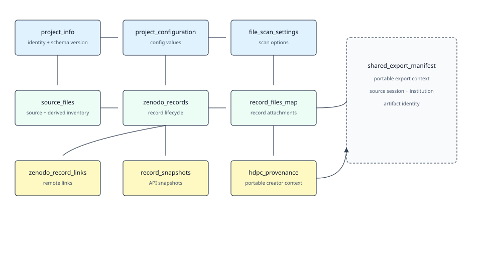

# HDPC Schema (`webhdp-local-2`)

This document describes the canonical WebHDP `.hdpc` SQLite schema used by the local-first session and Zenodo workflows.

## 1. Format Contract

- Storage engine: SQLite
- Canonical schema version: `webhdp-local-2`
- Authoritative schema marker: single-row `hdpc_schema_meta`
- Human-readable mirror: `project_info.hdpc_schema_version`

WebHDP creates new `.hdpc` files directly in this format and migrates older writable files in place.

## 2. Canonical Core Tables

| Table | Responsibility | Key fields |
|---|---|---|
| `hdpc_schema_meta` | Schema version marker | `meta_id`, `hdpc_schema_version`, `updated_timestamp` |
| `project_info` | One-row project identity and timestamps | `project_id`, `project_name`, `project_short_code`, `hdpc_schema_version` |
| `project_configuration` | Arbitrary project-scoped config values | `project_id`, `config_key`, `config_value` |
| `file_scan_settings` | One row per modality for scan setup | `project_id`, `modality`, `scan_options` |
| `source_files` | Source and derived file inventory | `file_id`, `project_id`, `absolute_path`, `relative_path`, `filename`, `file_type`, `status`, `parent_file_id`, `validation_report_json` |
| `zenodo_records` | Local record lifecycle and remote identity | `record_id`, `project_id`, `source_file_id`, `record_status`, `zenodo_record_id`, `concept_rec_id`, `version`, `version_rank`, `previous_record_id` |
| `record_files_map` | Files attached to a record | `record_id`, `file_id`, `file_path`, `file_purpose`, `upload_status` |
| `zenodo_record_links` | Named remote links for a record | `record_id`, `link_rel`, `link_url` |
| `zenodo_record_snapshots` | Stored remote/local API snapshots | `record_id`, `snapshot_stage`, `http_status`, `payload_json` |
| `hdpc_provenance` | Portable creator and institution provenance | `creator_user_public_id`, `institution_public_id`, `source_session_id` |
| `shared_export_manifest` | Shared export provenance | `artifact_kind`, `source_session_id`, `source_institution_id`, `source_owner_user_id`, portable identity fields |

## 3. Core Relationships

Key FK behavior:
- `source_files.parent_file_id` is self-referential and cascades on delete.
- `zenodo_records.source_file_id` is nullable and uses `ON DELETE SET NULL`.
- `zenodo_records.previous_record_id` captures version lineage and uses `ON DELETE SET NULL`.
- `record_files_map` rows cascade with both the parent record and attached source file.

## 4. Important Field Semantics

### 4.1 Versioning

- `zenodo_records.version` is a display label only.
- `zenodo_records.version_rank` is the sortable version ordinal.
- `zenodo_records.previous_record_id` captures explicit lineage between versions.

This avoids ordering records purely by free-form `version` strings.

### 4.2 Creator Provenance

- `hdpc_provenance` is a single-row table for portable creator context.
- It stores internal-profile-safe identifiers such as `creator_user_public_id`, optional profile URLs, and institution identity.
- Local integer IDs remain outside this table except `source_session_id`, which is only a same-deployment breadcrumb.

### 4.3 Validation Reporting

- `source_files.error_message` stores a concise operator-facing error.
- `source_files.validation_report_json` stores the structured validation payload.

Legacy rows that stored JSON inside `error_message` are migrated into `validation_report_json`.

### 4.4 Scan Settings

- `file_scan_settings` is normalized to one row per modality.
- JSON array payloads previously stored in `modality` are split into separate rows with duplicated `scan_options`.

### 4.5 Safe File Paths

- `source_files.absolute_path` is the only raw local path field.
- `record_files_map.file_path` is normalized to a safe project-relative path for exports and UI surfaces.

### 4.6 Zenodo Retrieval Records

Zenodo account retrieval shards are normal `.hdpc` files with explicit retrieval provenance.

Retrieval-generated records use:
- `zenodo_records.record_origin = "zenodo_retrieval"`
- `zenodo_record_snapshots.snapshot_stage = "account_retrieval_deposition"`
- `record_files_map.file_purpose = "retrieved_file"` for files described by Zenodo deposition metadata
- `record_files_map.upload_status = "retrieved_metadata_only"` because WebHDP did not upload these files during retrieval

Retrieval metadata is also stored in `project_configuration` keys:
- `retrieval.kind`
- `retrieval.id`
- `retrieval.shard_index`
- `retrieval.environment`
- `retrieval.window`
- `retrieval.manifest`

These files are generated from authenticated Zenodo deposition reads, not from WebHDP upload sessions. They should be displayed as retrieval records and treated as read-only explorer inventory.

Large account retrievals create many shards. A verified production retrieval completed with 83,657 records in 848 `.hdpc` files, all using `zenodo_retrieval` origin and `account_retrieval_deposition` snapshots. Consumers should therefore treat retrieval output as a shard manifest, not as a single monolithic `.hdpc`. Collection-level metadata tracks latest record timestamps for incremental follow-up retrievals, and optional compaction can create additional consolidated shard sessions without changing the original retrieval provenance.

## 5. Legacy Pass-Through Tables

These tables may be preserved when importing raw legacy `.hdpc` files, but WebHDP does not create or rely on them in hot paths:

- `batches`
- `metadata_mapping_files`
- `metadata_values`
- `project_pipelines`
- `api_log`
- `api_credentials`
- `metadata_backups`
- `component_configurations`

## 6. Migration and Repair Rules

Before enforcing the canonical schema, WebHDP repairs older `.hdpc` files by:

- creating `project_info` and backfilling missing `project_id` values
- adding missing core columns required by the canonical schema
- splitting multi-modality `file_scan_settings` rows
- moving JSON validation blobs out of `source_files.error_message`
- dropping invalid parent/source/record references
- creating a default `record_files_map` row for any record with `source_file_id` but no mapping
- backfilling `version_rank`
- normalizing mapped `file_path` values to project-relative paths

## 7. Shared Export Rules

Sanitized shared exports are allowlist copies, not backup-then-scrub clones.

Included core content:
- `project_info`
- safe `project_configuration` values
- `source_files`
- `zenodo_records`
- `record_files_map`
- `zenodo_record_links`
- `zenodo_record_snapshots`
- `hdpc_provenance`
- `shared_export_manifest`

Excluded by default:
- raw secrets and credential values
- non-allowlisted legacy tables
- raw local absolute paths

## 8. Hot-Path Indexes

The canonical schema creates indexes for the main read/write paths:

- `source_files(absolute_path)`
- `source_files(parent_file_id)`
- `source_files(status)`
- `source_files(file_type)`
- `source_files(sha256_hash)`
- `source_files(filename, file_id)`
- `zenodo_records(record_status, is_sandbox)`
- `zenodo_records(source_file_id)`
- `zenodo_records(concept_rec_id, record_status, is_sandbox)`
- `zenodo_records(previous_record_id)`
- `zenodo_records(zenodo_record_id)`
- `record_files_map(record_id)`
- `record_files_map(file_id)`
- `record_files_map(upload_status)`
- `record_files_map(zenodo_file_key)`
- `zenodo_record_snapshots(record_id)`
- `zenodo_record_snapshots(snapshot_stage)`

The `source_files(sha256_hash)` index also supports global hash collision warnings during batch record-resolution analysis. WebHDP scans accessible `.hdpc` inventories for non-exempt source-file hashes and surfaces matching Zenodo records as advisory warnings before batch processing continues. Admin policy excludes small files, configured sidecar extensions, and generated render/preview outputs so the index is used for likely primary source assets rather than routine derived artifacts.

## 9. Where This Schema Is Used

Primary implementation entrypoints:
- `services/hdpc_schema_service.py`
- `services/hdpc_local_service.py`
- `services/hdpc_scan_service.py`
- `services/hdpc_zenodo_service.py`
- `services/hdpc_shared_export_service.py`
- `services/zenodo_account_retrieval_service.py`

Primary API surfaces:
- session `.hdpc` download and shared export
- session project/file/record summary endpoints
- versioning and draft discard routes
- shared export import
- Zenodo account retrieval shard generation and explorer-only sessions

Related reference:
- `../api/webhdp_api_reference.md`
- `../guides/zenodo_account_retrieval.md`
