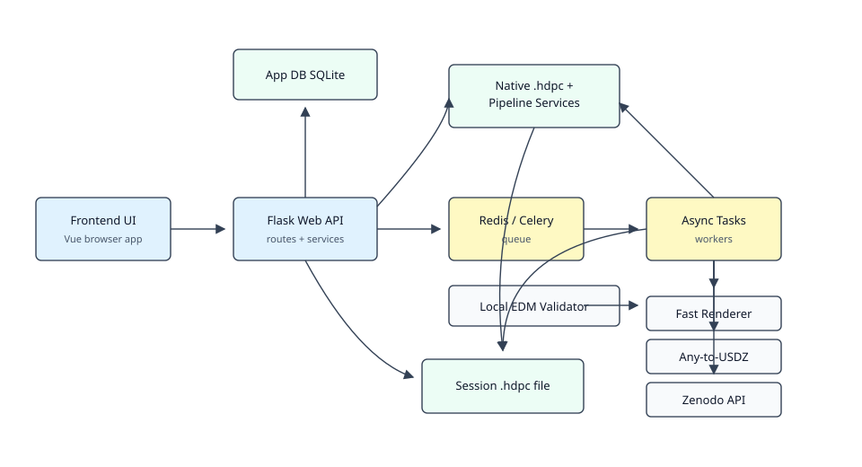

# WebHDP System Architecture

## 1. System Goal
WebHDP transforms raw research assets (especially 3D files) and metadata into publication-ready outputs with reproducible provenance:
- Zenodo records (draft/published)
- EDM XML
- IIIF manifest
- METS XML
- Session and cross-session lineage views

## 2. High-Level Components

| Component | Responsibility |
|---|---|
| Vue Frontend (`frontend/`) | User workflow, setup wizard, admin UI, provenance dashboards |
| Flask Web API (`app.py`, `routes/`, `services/`) | Session orchestration, metadata management, template rendering, API layer |
| Native `.hdpc` + pipeline services (`services/hdpc_*`, `services/native_pipeline_*`) | Local project state, canonical `.hdpc` schema/migration, record lifecycle, component import, pipeline/playground execution |
| Celery + Redis (`tasks.py`) | Async ingestion/pipeline execution, progress tracking |
| Local EDM Validator (`local-edm-validator`) | Fast local EDM RDF/XML validation, full validation report output, Actuator health/info metadata |
| Fast Renderer (`external_code/fast_renderer`) | Optional 2D preview rendering from 3D assets |
| Any-to-USDZ (`external_code/any_to_usdz`) | Optional conversion to USDZ |
| SQLite (`instance/hdp_web.db`) | Application state (users, sessions, submissions, templates, config) |
| `.hdpc` SQLite session files | Per-session local project and Zenodo records |

## 2.1 API Boundary

| API Surface | Owns | Does Not Own |
|---|---|---|
| WebHDP API (`/api/v1/...`, `/api/v2/...`) | Auth, RBAC, session lifecycle, `.hdpc` project mutation/query, native component import, native pipeline execution, moderation/admin workflows, docs endpoints | Archived legacy HDP-Server administration |

Operational rule:
- UI clients call WebHDP API.
- WebHDP API uses native `.hdpc` and native pipeline services exclusively.

## 3. Main Runtime Data Flow

The generated graphic shows the same operational boundary as the runtime
contract: the browser talks to the Flask API, durable state lives in SQLite and
session `.hdpc` files, asynchronous work runs through Redis/Celery, and optional
processing or validation services are called only where enabled.

## 4. Workflow Lifecycle (What Happens and Why)

### Step A: Session Initialization
What happens:
- User uploads a file or starts directory/ZIP ingestion.
- Backend creates isolated session directories and DB session record.

Why it exists:
- Ensures isolation, reproducibility, and clean provenance boundaries per submission run.

### Step B: Ingestion + MSF Matching
What happens:
- Files are scanned.
- MSF metadata is parsed and matched to file names.
- Batch metadata can be persisted per file.
- The session stops at a resumable `scanned` state after registration.
- No local Zenodo record is created during upload.

Why it exists:
- Prevents metadata drift and ensures file-level metadata precision in batch workflows.

### Step C: Metadata Authoring/Validation
What happens:
- User metadata draft is saved.
- Strict validation is applied before final save.

Why it exists:
- Catches schema and semantic issues early, before expensive processing/publishing stages.

### Step D: Template Preview + Validation
What happens:
- EDM template renders with current metadata.
- XML validation combines structural, XSD, Schematron, business-rule checks, and the local-edm-validator report.
- The local report includes validator steps, messages, problem patterns, and timing data.

Why it exists:
- Checks standards alignment and metadata quality before publication.

### Step E: Pipeline Execution
What happens:
- First submit creates canonical local records in the session `.hdpc`.
- Reruns and post-submit operations execute against persisted `record_id` values.
- Optional render and USDZ conversion run.
- EDM/IIIF/METS files are generated.
- LOD generation follows explicit `required` / `optional` / `disabled` policy.
- Generated EDM is validated with local-edm-validator when enabled, and the full report is persisted as `edm.validation.json` plus `.hdpc` source-file metadata.
- Zenodo draft and file upload steps execute under the session's resolved publishing context.

Why it exists:
- Converts interactive metadata preparation into a traceable machine pipeline with measurable timing and status.

### Step F: Provenance & Post-Processing Exploration
What happens:
- Session records endpoints reconstruct record/file lineage.
- Session-level report and cross-session explorer aggregate outcomes.

Why it exists:
- Supports scientific accountability, auditability, and repeatability.

## 4.1 Migration Outcome
- Standard deployment and runtime are fully self-contained within WebHDP.
- Project bootstrap, `.hdpc` mutation, and pipeline execution run through native local services only.

## 4.2 Workflow Ownership Rules
- Upload owns session creation, file registration, MSF analysis, and resumable scan metadata only.
- Submit owns first-time record creation.
- Record explorer, batch operations, publish/upload/discard, and versioning own existing records only.
- Legacy upload-created placeholder rows are hidden from the canonical explorer surfaces and may be marked `legacy_placeholder` during maintenance cleanup.

## 4.3 Canonical State Model

### Session states
- `queued`: upload/scan work is still active
- `scanned`: upload/scan work completed and the workflow can resume
- `submitting`: a submission pipeline run is active
- `completed`: the latest submission completed successfully
- `failed`: the latest upload or submission path ended in a blocking failure

### File states
- `queued`
- `registered`
- `missing`
- `selected`
- `processed`
- `failed`

Download and resume surfaces normalize legacy values such as `pending`, `ready`, and `active` into this canonical model.

## 4.4 Publishing Context Resolution
- Environment defaults to the session's `default_zenodo_environment` unless the caller explicitly overrides it.
- If `credential_preference=user` and the publishing user has an active Zenodo credential for that environment, that active key is authoritative.
- Active user credentials may be owned by the publishing user or accepted shares from another user. Pending, declined, revoked, deleted, inaccessible, or wrong-environment shares never resolve for uploads.
- Otherwise, if the session is institution-linked and the institution has a credential for that environment, the institution credential is used.
- Otherwise, WebHDP falls back to the system environment token.
- User-managed Zenodo keys are stored encrypted and surfaced only as masked previews. Sharing grants use of the encrypted credential record; it does not expose the cleartext token to the recipient, administrators, API responses, validation reports, or audit details.
- Institution default communities are merged only when `use_institution_default_communities` is enabled for the session.

## 4.5 LOD Policy Contract
- `required`: LOD generation failure marks the record as failed and blocks the Zenodo upload step.
- `optional`: LOD generation failure is retained as record-level warning/error detail but does not block upload.
- `disabled`: LOD generation is skipped and recorded as skipped.
- Submit-time MSF discovery checks configured/custom paths first, then `upload.msf.xlsx`, `upload.msf.xls`, and `upload.msf.csv`.
- EDM validation uses `LOCAL_EDM_VALIDATOR_URL` when `ENABLE_LOCAL_EDM_VALIDATION=true`; legacy METIS environment names remain compatibility aliases.

## 5. Storage Modes
WebHDP supports multiple operational modes controlled via storage configuration:
- `pure_cloud`
- `cloud_backup`
- `server_only`
- `local` (HPC/local-drive style scanning)

Detailed mode behavior: `../storage_modes_architecture.md`.

## 6. Security and Access Control Model
- JWT-based API authentication for authenticated routes
- Role model: `user`, `moderator`, `admin`
- Admin-only configuration and destructive actions are explicitly guarded
- Session ownership enforced for user-scoped records and downloads

## 7. Failure and Degraded Operation Design
- Async tasks return explicit status and progress
- Session records APIs expose `source_state` for degraded `.hdpc` availability
- Optional components (renderer/USDZ) can be disabled via feature flags
- Low-resource deployments can keep metadata/publication workflow active

## 8. Key Persistence Entities
- `users`, `sessions`, `files`, `submissions`, `submission_reviews`
- `user_metadata`, `batch_file_metadata`
- `system_config` (runtime/admin configuration)
- Session-specific `.hdpc` files containing HDP-side processing/record data

## 8.1 HDPC Schema Contract

WebHDP now treats `.hdpc` as a versioned SQLite format with one canonical writable schema:

- authoritative version marker in `hdpc_schema_meta`
- mirrored schema version in `project_info.hdpc_schema_version`
- core writable tables for project info/config, scan settings, source files, Zenodo records, file mapping, links, and snapshots
- safe shared-export allowlist rather than backup-then-scrub cloning

Primary reference: `hdpc_schema.md`.

## 9. Traceability Surfaces
- Submission progress payloads
- Session record detail endpoint (`/sessions/<id>/records/<record_id>`)
- Session workspace intelligence endpoint (`/sessions/<id>/workspace-summary`)
- Session lineage and Zenodo state endpoints (`/sessions/<id>/records/<record_id>/lineage`, `/sessions/<id>/records/<record_id>/zenodo-status`)
- Session operations summary and native batch operations (`/sessions/<id>/operations/summary`, `/sessions/<id>/batch-operations`)
- Session provenance report endpoint (`/sessions/<id>/provenance-report`)
- Cross-session explorer endpoint (`/sessions/records/explorer`)

## 9.1 Native Replacement Surfaces
WebHDP does not port the remaining HDP-Server API families route-for-route. Instead, it replaces the useful legacy behavior with higher-level product surfaces:

- Session intelligence:
  - `workspace-summary`
  - `lineage`
  - `zenodo-status`
  - `operations-summary`
- Native async session batch orchestration:
  - `POST /sessions/<id>/batch-operations`
  - task listing/status routes under the same session scope
- Admin observability:
  - `GET /admin/observability/credentials-status`
  - `GET /admin/observability/api-activity`
  - `POST /admin/observability/checks/<check_id>`

These are the preferred WebHDP-native replacements for fragmented legacy `data_query`, `batch_action`, and operability/credentials/API-log surfaces.

## 10. Pipeline Model: Current vs Planned

Current (implemented):
- WebHDP integration provides predefined/default pipeline definitions (`render`, `metadata_only`) as fallback seeds.
- These defaults are stored in `constants.py` and ensured via the WebHDP orchestration layer.
- Pipeline execution accepts file-based first submit and `record_ids`-based rerun/reprocess paths.
- The first public repository release treats `render` and `metadata_only` as the stable supported pipeline paths.
- HPC-linked execution and installable component surfaces are available for
  evaluated deployments, but remote HPC deployment itself is not part of
  repository release preparation.

Planned (future updates):
- Move to broader HDP component-driven pipeline composition and execution as the primary model, building on the local Docker/HPC SIF installer strategies.
- Reduce reliance on predefined/hardcoded default-oriented pipeline behavior.

Roadmap reference: `../guides/planned_future_updates.md`.
