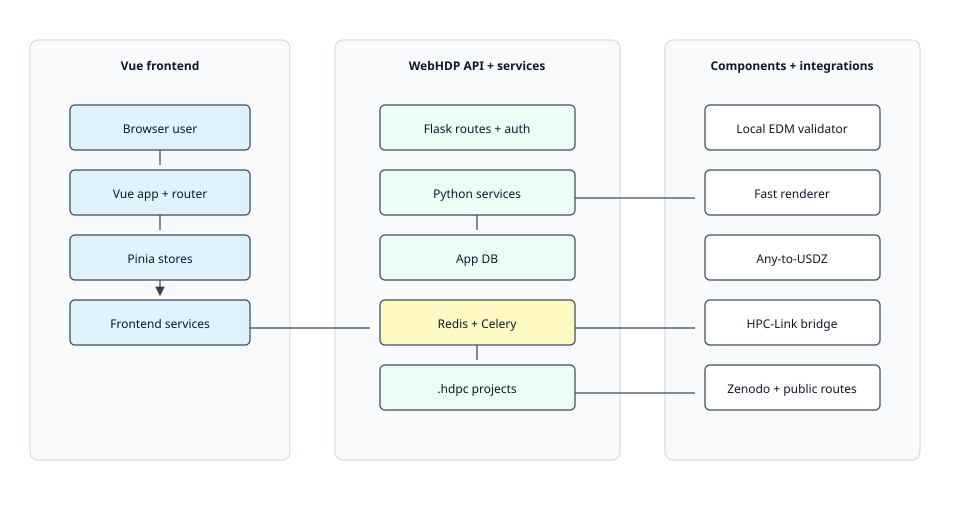
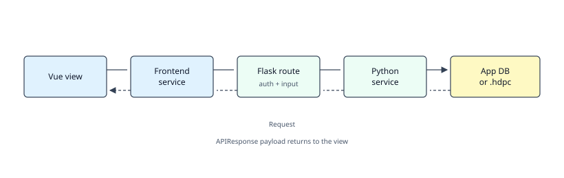

# Contributor Architecture Map

Use this map to answer: where does this behavior live, which layer owns it, and which tests should move with it?

This is a developer onboarding map. The deeper product and deployment architecture lives in `../architecture/system_architecture.md`.

## 1. Runtime Map

## 2. Request Ownership

Rules of thumb:

- Views orchestrate screen behavior.
- Frontend services own HTTP calls.
- Routes own HTTP translation and permission boundaries.
- Services own business rules and side effects.
- Models and migrations own app database shape.
- `.hdpc` services own project/session SQLite artifacts.
- Tasks own background execution, but shared logic still belongs in services.

## 3. Change Ownership Table

| If you change... | Primary owner | Also inspect | Typical checks |
|---|---|---|---|
| A visible route/page | `frontend/src/views/`, `frontend/src/router/index.js` | matching service/store/test | `cd frontend && npm run test:unit -- name` |
| Frontend API behavior | `frontend/src/services/` | route response shape, view tests | service or view Vitest |
| Backend endpoint | `routes/` | `services/`, `docs/api/openapi.json`, frontend service | route pytest, `make api-contract` |
| Business rule | `services/` | callers in routes/tasks/tests | focused service or route pytest |
| Permission boundary | backend route/decorator first | router guards and UI affordances | route permission test plus guard test |
| App database schema | `database/models.py`, `migrations/versions/` | services and fixtures | migration/model pytest |
| `.hdpc` schema or access | `services/hdpc_*`, `docs/architecture/hdpc_schema.md` | golden workflow and import/export tests | `tests/test_hdpc_*`, `make golden-workflow` |
| Workflow state | workflow services, tasks, frontend workflow store | architecture docs and resumed sessions | workflow pytest plus frontend workflow tests |
| Background task | `tasks.py` and called service | progress payload consumers | task/service pytest |
| Zenodo publishing | Zenodo services and credential services | API docs, operations guide, security notes | Zenodo service/route pytest |
| Local EDM validation | EDM/local validator services | compose override, operator docs | local validator tests |
| Public record/oEmbed | public routes and public services | frontend public views, API docs | public route/service tests |
| HPC bridge | `hpc-link/` | WebHDP client routes only if integrated | `cd hpc-link && python -m pytest` |
| Devcontainer/onboarding | `.devcontainer/`, `Makefile`, `scripts/doctor.py`, `docs/development/` | CI onboarding jobs | `make doctor`, `make devcontainer-check` |

## 4. Backend Layer Map

| Layer | Path | What belongs here | What does not belong here |
|---|---|---|---|
| App bootstrap | `app.py`, `config.py`, `routes/__init__.py` | extension setup, blueprint registration, global config | feature business rules |
| HTTP routes | `routes/` | request parsing, auth checks, service calls, response shape | reusable domain logic |
| Services | `services/` | workflow rules, persistence orchestration, external clients | Flask request-specific behavior |
| Models | `database/models.py` | app DB entities, relationships, constraints | `.hdpc` project schema |
| Migrations | `migrations/versions/` | durable app DB changes | ad hoc runtime repair |
| Schemas | `schemas/` | structured payload contracts | route-specific one-off parsing |
| Tasks | `tasks.py` | Celery entry points, progress reporting | logic that routes also need |
| Scripts | `scripts/` | developer/operator automation | hidden runtime dependencies |

## 5. Frontend Layer Map

| Layer | Path | What belongs here |
|---|---|---|
| Router | `frontend/src/router/index.js` | route definitions, route metadata, guard UX |
| Views | `frontend/src/views/` | page-level orchestration and data loading |
| Components | `frontend/src/components/` | reusable UI and workflow elements |
| Services | `frontend/src/services/` | API calls and response normalization |
| Stores | `frontend/src/stores/` | cross-view state, session persistence |
| Utilities | `frontend/src/utils/` | pure helpers and data transformations |
| Tests | `frontend/tests/` | view, store, utility, and guard behavior |

## 6. Persistence Map

WebHDP has more than one persistence boundary:

| Store | Owner | Used for | Be careful with |
|---|---|---|---|
| App database | SQLAlchemy models | users, roles, credentials, institutions, sessions, notifications, public visibility | migrations and permissions |
| `.hdpc` SQLite files | `.hdpc` services | project/session record state, scans, local artifacts, explorer collections | schema compatibility and import/export |
| Filesystem storage | project/file services | uploads, generated files, reports, exports | local path exposure and storage modes |
| Browser storage | Pinia/workflow store | current UI workflow continuation | resumed sessions and stale client state |
| Redis | Celery/worker stack | background task broker/result coordination | optional inline-task mode |

## 7. External Boundary Map

| Boundary | Local abstraction | Notes |
|---|---|---|
| Zenodo | Zenodo credential, publishing, retrieval, metadata services | never log or return cleartext tokens |
| Local EDM validator | local EDM validator client/service | optional integration with clear health reporting |
| Fast renderer | renderer service/component | optional; must degrade clearly |
| Any-to-USDZ | conversion service/component | optional processing boundary |
| Cloud storage | cloud storage/upload services | depends on storage mode and credentials |
| HPC Link | `hpc-link/` service and WebHDP client | independent deployable bridge |

## 8. Which Test First?

| Change scope | Start with |
|---|---|
| Docs only | `make docs-check` |
| Onboarding or setup | `make doctor` |
| API route | focused `uv run pytest tests/test_route_name.py -q` |
| Service logic | focused service pytest |
| Frontend view | `cd frontend && npm run test:unit -- viewName` |
| Router guard | `cd frontend && npm run test:unit -- routerGuards` |
| Workflow fixture behavior | `make golden-workflow` |
| Devcontainer | `make devcontainer-check` and, when Docker is available, `devcontainer up` |
| Cross-layer behavior | focused backend test, focused frontend test, then `make verify-onboarding` |

## 9. When To Update Docs

Update docs in the same PR when you change:

- setup commands or environment variables
- route paths, permissions, or response contracts
- workflow states or persisted record behavior
- `.hdpc` schema or import/export behavior
- credentials, tokens, public visibility, or security-sensitive flows
- Docker, Compose, Devcontainer, or CI behavior
- external integrations such as Zenodo, EDM validation, renderer, USDZ, cloud storage, or HPC Link

If the change creates or changes an architectural rule, add or update an ADR in `adr/`.
