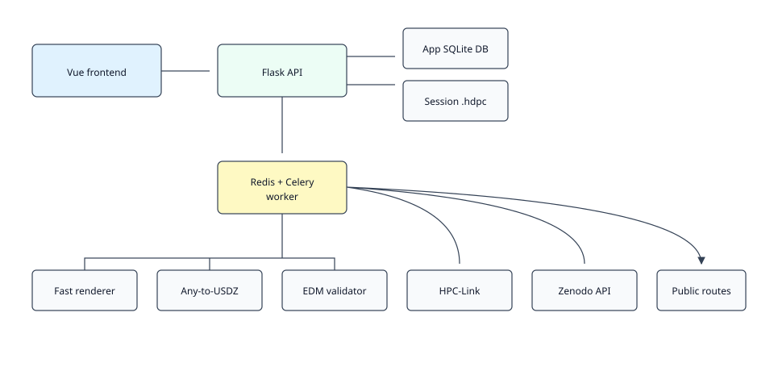

# WebHDP Contributor Handbook

This handbook formalizes how the codebase is organized and how contributors should reason about changes. It is intentionally practical: use it to decide where code belongs, which contracts must stay stable, and which checks prove a change is ready.

If you are setting up the project for the first time, start with `onboarding.md`. When you need a concrete implementation pattern, use `examples.md`.

## 1. Contribution Principles

- Preserve provenance. Uploads, scans, generated files, Zenodo records, and `.hdpc` state are part of a scientific audit trail.
- Keep contracts explicit. If behavior affects API responses, background progress payloads, session states, credential resolution, or storage modes, document it.
- Put logic in the right layer. Routes translate HTTP; services own business rules; models own persistence shape; frontend services own API calls; views orchestrate screens.
- Prefer narrow, tested changes. The application crosses authentication, async tasks, filesystems, validators, and external APIs, so regression blast radius matters.
- Treat production and low-resource deployments as first-class. Optional integrations must degrade clearly.

## 2. Onboarding At A Glance

| Goal | Start Here | Main Commands |
|---|---|---|
| Understand the product | `README.md` and `../architecture/system_architecture.md` | None |
| Start with a ready environment | `devcontainer.md` | `Dev Containers: Reopen in Container` |
| Diagnose my workspace | `troubleshooting_decision_tree.md` | `make doctor` |
| Open my first PR | `first_pr_walkthrough.md` | `make doctor`, then the area check |
| Find the owning layer | `architecture_map.md` | The focused check for that layer |
| Decode WebHDP terms | `developer_glossary.md` | None |
| Keep a PR reviewable | `pr_scope_examples.md` | The verification list for that scope |
| Triage noisy output | `known_warnings.md` | Re-run the command and trust the exit code first |
| Make a docs-only change | `onboarding.md`, then the relevant file under `docs/` | `git diff --check` |
| Work on backend behavior | `routes/`, `services/`, `tests/` | `uv sync --group dev`, `uv run pytest` |
| Work on frontend behavior | `frontend/README.md`, `frontend/src/`, `frontend/tests/` | `cd frontend && npm ci && npm run test:unit && npm run build` |
| Run the whole app locally | `README.md` quick start | `cp .env.example .env`, `docker compose up --build` |
| Prove local workflow basics | `golden_workflow.md` | `make golden-workflow` |
| Build an HDP Component | `first_hdp_component.md` | `uv run python scripts/validate_hdp_components.py external_code/<component_name>` |
| Work on HPC Link | `hpc-link/` | `cd hpc-link && python -m pytest`; `cd hpc-link/frontend && npm run lint && npm run build` |
| Copy an implementation pattern | `examples.md` | The checks listed in the relevant example |
| Choose a starter task | `good_first_changes.md` | The checks listed for that task area |
| Validate onboarding artifacts | `Makefile` | `make doctor`, then `make verify-onboarding` |
| Change API routes | `docs/api/openapi.json` | `make api-contract`, then `make api-contract-check` |

For your first contribution, pick one surface and one test path. A small, well-tested change is easier to review than a broad change that crosses workflow, database, and UI contracts at once.

## 3. Runtime Topology



The shipped workflow contract is documented in `../architecture/system_architecture.md`. In short: upload/scan ends in `scanned`; submit owns first-time record creation; reruns and publishing operate on persisted `record_id` values.

## 4. Directory Map

| Path | Responsibility | Contributor Notes |
|---|---|---|
| `app.py` | Flask app setup, extension wiring, global services, health/static compatibility routes | Avoid adding feature logic here unless it is application bootstrap or a tiny compatibility endpoint. |
| `routes/` | HTTP endpoints and auth/role boundaries | Keep endpoints thin. Validate input, call services, return `APIResponse`-style payloads. Register new blueprints in `routes/__init__.py`. |
| `services/` | Business logic, external clients, workflow orchestration | Preferred home for reusable behavior. Keep side effects explicit and test service behavior directly where possible. |
| `database/` | SQLAlchemy app models, DB initialization, seed helpers | Schema changes need migrations and tests for important constraints. |
| `migrations/versions/` | Alembic migrations | Use deterministic upgrades/downgrades and avoid data loss unless explicitly documented. |
| `schemas/` | Pydantic/structured validation contracts | Use for API and pipeline payloads that need validation across layers. |
| `tasks.py` | Celery tasks and progress persistence | Keep task payloads backwards compatible for UI polling where possible. Use services for non-task business rules. |
| `frontend/src/services/` | Browser API client modules | Centralize endpoints here instead of scattering `fetch`/`axios` calls in views. |
| `frontend/src/stores/` | Pinia state shared across views | Keep persisted workflow state compatible with existing sessions. |
| `frontend/src/views/` | Route-level screens | Coordinate data loading and user flows. Reuse components and services. |
| `frontend/src/components/` | Reusable UI elements and workflow components | Keep components focused and props/events explicit. |
| `frontend/tests/` | Vitest unit/integration tests | Prefer behavior tests around stores, views, API service calls, and workflow state. |
| `frontend/e2e/` | Playwright browser flows | Use when routing, auth, workflow sequencing, or browser-only behavior changes. |
| `hpc-link/` | Optional FastAPI bridge and React frontend for HPC workflows | Keep this deployable independently; document any WebHDP integration assumptions. |
| `external_code/` | Optional processing microservices and HDP Component definitions | Treat as service boundaries. Use `first_hdp_component.md` for new manifest-backed containers and keep component metadata accurate. |
| `docs/` | Product, operator, API, architecture, and developer documentation | Update docs in the same change that alters behavior or setup. |
| `tests/` | Python backend tests | Add focused tests for route permissions, service contracts, migrations, and workflow regressions. |

## 5. Backend Conventions

### Request Flow

1. A blueprint in `routes/` receives the request.
2. Auth, role, session, and content-type checks happen at the route or decorator/middleware layer.
3. The route normalizes request data and calls one or more services.
4. Services perform business logic, persistence, external calls, and artifact coordination.
5. Responses use the existing API response shape so frontend services can consume them consistently.

### Route Rules

- Use `/api/v1/...` for stable WebHDP surfaces and `/api/v2/...` only where the existing v2 pipeline contract applies.
- Add route-level tests for new permissions, ownership checks, validation failures, and happy paths.
- Keep public routes explicit and review them as security-sensitive.
- Do not return secrets, local filesystem internals, or raw traceback details to clients.

### Service Rules

- Services should be usable from both routes and tasks when the behavior is shared.
- External API clients should isolate timeout, retry, credential, and response-normalization behavior.
- When changing Zenodo, credential, `.hdpc`, cloud, or validator behavior, update the relevant architecture or operations docs.

### Database And Migrations

- App state lives in SQLAlchemy models in `database/models.py`.
- Session/project processing state lives in `.hdpc` files and is versioned separately. See `../architecture/hdpc_schema.md`.
- Prefer additive migrations for production safety.
- Include constraints for invariants that must survive concurrent workers.
- Test important migrations or model constraints, especially around auth, credentials, sessions, notifications, and public visibility.

### Background Tasks

- Celery is configured through `celery_app.py`; inline task mode exists for single-process or constrained environments.
- Tasks should persist progress in stable JSON payloads because the UI and dashboards poll them.
- Long-running tasks should report stage, current item, counts, warnings, and terminal status.
- On failure, persist enough context for operators without logging tokens or private payloads.

## 6. Frontend Conventions

### Application Shape

- Vue 3, Vite, Pinia, Vue Router, and service modules under `frontend/src/services/`.
- `frontend/src/router/index.js` defines public, authenticated, moderator, and admin route boundaries.
- `frontend/src/stores/workflow.js` persists current workflow state in `sessionStorage`; changes here can affect resumed sessions.

### UI And State Rules

- Views own screen orchestration; services own API calls; stores own cross-view state.
- Keep route guards aligned with backend permission checks. Frontend guards improve UX but do not replace backend authorization.
- Normalize backend payloads in services or small utilities when multiple views need the same shape.
- Update Vitest coverage for stores, utilities, and view behavior when user workflows change.
- Use Playwright when changes depend on real routing, browser storage, authentication flow, uploads, or modals.

## 7. HPC Link Boundary

`hpc-link/` is a separate FastAPI service with its own React frontend. It handles SSH/HPC connectivity, file browsing, job submission, terminal/websocket flows, and app gateways.

- Backend entry point: `hpc-link/app/main.py`
- Backend routers: `hpc-link/app/routers/`
- Backend tests: `hpc-link/tests/`
- Frontend entry point: `hpc-link/frontend/src/main.tsx`
- Frontend pages/API clients: `hpc-link/frontend/src/pages/`, `hpc-link/frontend/src/api/`

Changes that affect both WebHDP and HPC Link should describe both deployment surfaces in the pull request.

## 8. Local Development

### Recommended First Setup

For most contributors, the least surprising setup is:

```bash
uv sync --group dev
cd frontend && npm ci
```

Then choose either a focused local process setup or Docker, depending on what you need to test.

### Root Backend

```bash
uv sync --group dev
cp .env.example .env
uv run flask --app app run --debug
```

If you do not have Celery/Redis running and need single-process behavior for development, set:

```bash
WEBHDP_INLINE_TASKS=true
```

### Frontend

```bash
cd frontend
npm ci
npm run dev
```

The frontend API base is normalized by `frontend/src/services/apiBase.js`; check environment files before changing API roots.

### Docker

```bash
cp .env.example .env
docker compose up --build
```

Use `docker-compose.dev.yml`, `docker-compose.low-resource.yml`, `docker-compose.hpc.yml`, or `docker-compose.prod.yml` only for the deployment profile they are meant to describe.

## 9. Test Matrix

| Change Type | Minimum Checks |
|---|---|
| Backend route or service | `uv run pytest` or focused `uv run pytest tests/test_name.py` |
| Auth, RBAC, session ownership | Route permission tests plus negative tests |
| Database model/migration | Migration/model tests and full backend suite when feasible |
| Celery task/progress payload | Service/task tests plus UI polling behavior if changed |
| Vue service/store/utility | `cd frontend && npm run test:unit` |
| Vue workflow screen | Relevant Vitest view tests; Playwright for browser-flow changes |
| Frontend build/runtime config | `cd frontend && npm run build` |
| HPC Link backend | `cd hpc-link && python -m pytest` |
| HPC Link frontend | `cd hpc-link/frontend && npm run lint && npm run build` |
| Compose/deployment | `docker compose config --quiet`; production compose check when production files change |
| Docs-only | Verify links/commands manually; run code tests only if docs describe changed executable behavior |

Run `cd frontend && npm run test:e2e:core` for workflow guidance/recovery changes,
and `npm run test:e2e:backend` for changes across upload, metadata, readiness or
processing. The latter runs Chromium and Firefox against the isolated Flask
fixture in `tests/browser_api.py`, using real HTTP routes and persistence with
only external execution/delivery replaced. It checks reload/lost acknowledgement,
partial failure, saved-record continuation and verified derivative previews.
It does not establish acceptance of an installed compute component.

Measure local batch readiness with
`uv run python scripts/benchmark_submission_readiness.py --counts 10 100 1000 --inventory-size 10000`.
The benchmark scans real small GLBs and measures progress/elapsed time while
injecting unrelated inventory records. Inventory is loaded once per check, and
source hashes remain fresh. Large-model and deployment storage throughput need
separate measurement. CPU LOD corpus and disconnected deployment gates are in
[`external_code/geometric_lod_generator/validation/README.md`](../../external_code/geometric_lod_generator/validation/README.md).

## 10. Common Contribution Recipes

### Add A WebHDP API Endpoint

1. Add or extend a blueprint in `routes/`.
2. Put business behavior in a service under `services/`.
3. Add schema validation in `schemas/` if the payload is non-trivial or reused.
4. Register the blueprint in `routes/__init__.py` if it is new.
5. Add route tests for auth, authorization, validation, and success.
6. Update `docs/api/webhdp_api_reference.md` and examples if the endpoint is public or integrator-facing.

### Add A Frontend Workflow Capability

1. Add API calls in `frontend/src/services/`.
2. Add or update shared state in `frontend/src/stores/` only if multiple views need it or it must persist.
3. Implement route-level behavior in `frontend/src/views/`.
4. Extract reusable UI into `frontend/src/components/`.
5. Add Vitest coverage and Playwright coverage when the browser flow changes.

### Add A Database Field

1. Update `database/models.py`.
2. Add an Alembic migration in `migrations/versions/`.
3. Update serialization methods and API docs when the field is exposed.
4. Add tests for defaults, constraints, and compatibility with existing rows.

### Add A Background Operation

1. Put core behavior in a service.
2. Add the Celery task wrapper in `tasks.py`.
3. Persist progress and final status using the existing task history pattern if one exists for that domain.
4. Add route or service tests and frontend polling tests if UI state changes.
5. Document operator failure modes and retry behavior.

## 11. Documentation Rules

- Update `README.md` for high-level capabilities, quick start, or documentation index changes.
- Update `docs/architecture/` for system contracts, state models, persistence rules, and cross-service boundaries.
- Update `docs/api/` for endpoint, request, response, auth, or versioning changes.
- Update `docs/guides/` for user/operator workflows.
- Update `docs/workflows/` when a UI path, API workflow, background job, native pipeline, operator script, or public record flow changes. Follow the canonical structure in `../workflows/README.md#workflow-document-structure`.
- Update this handbook when contributor expectations or directory ownership changes.
- Prefer concrete commands and file paths over prose-only descriptions.

## 12. Security And Privacy Review Checklist

Before merging changes around auth, credentials, public pages, uploads, external calls, or logging, verify:

- Backend permission checks match the intended role and ownership model.
- Frontend route guards align with backend rules.
- Cleartext tokens, recovery codes, passwords, and private file paths are not returned or logged.
- Upload paths, ZIP extraction, filenames, and cloud/HPC paths use existing safe helpers.
- Public and oEmbed responses expose only intentionally public data.
- New configuration has safe development defaults and explicit production requirements.

## 13. Current Formalization Gaps To Improve Over Time

These are not blockers for normal contribution, but they should be improved over time:

- Split `app.py` further into an application factory and route/service bootstrap modules.
- Continue moving legacy root static files (`index.html`, `app.js`, `styles.css`) behind an explicit compatibility note or retirement plan.
- Add a generated OpenAPI description for the Flask API once route schemas are consistent enough.
- Add precise request/response schemas to the generated OpenAPI contract as route payload validation becomes more complete.
- Add a migration testing helper for upgrade/downgrade smoke checks.
