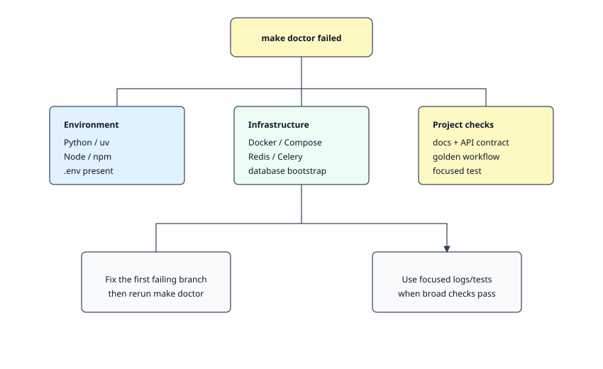

# Developer Troubleshooting Decision Tree

Use this page when something fails during onboarding or local development. Start at the first matching symptom, run the smallest check, then move outward only if the local check passes.

## 1. Start With The Doctor

```bash
make doctor
```

If `make doctor` passes, your local prerequisites, dependency installs, documentation catalog, OpenAPI contract, golden workflow, and whitespace checks are healthy.

If `make doctor` fails, use the matching branch below.

## 2. Doctor Failed



Common fixes:

| Doctor finding | Meaning | Fix |
|---|---|---|
| Python mismatch | The active interpreter does not match `.python-version` | Use Python 3.11 or reopen in the devcontainer |
| `uv` missing | Python dependency manager is unavailable | Install `uv` or use the devcontainer |
| Node too old | Vite requires Node 22.12 or newer | Use Node 22 from `.nvmrc` |
| Frontend toolchain failed | `node_modules` exists but native optional packages are broken | `cd frontend && npm ci`; remove `frontend/node_modules` first if needed |
| `.env` missing | Compose/full-stack checks need local config | `cp .env.example .env` |
| Docker daemon unavailable | Docker CLI exists but Docker Desktop is stopped | Start Docker Desktop |
| API contract stale | Flask routes changed without regenerating `docs/api/openapi.json` | `make api-contract` |
| Golden workflow failed | Fixture scan, `.hdpc`, or MSF matching regressed | `uv run python scripts/run_golden_workflow.py --json` |

## 3. Frontend Is Blank Or Fails To Start

1. Confirm Node:

```bash
node --version
```

Use Node 22.12 or newer.

2. Reinstall frontend packages:

```bash
cd frontend
npm ci
```

3. Start Vite:

```bash
npm run dev -- --host 0.0.0.0
```

4. If Rollup reports a missing native package, reinstall dependencies on the same operating system where you run Vite:

```bash
cd frontend
rm -rf node_modules
npm ci
```

The devcontainer intentionally mounts `frontend/node_modules` as a named volume so Linux packages do not replace host-machine packages.

5. If the app loads but API calls fail, move to the API branch.

If Vite or Vitest stalls before reporting startup, isolate configuration bundling
with Vite's runner loader. From `frontend/`:

```bash
npm run test:unit -- --configLoader runner
npm run build -- --configLoader runner
```

For browser checks against the resulting production build, start the preview in
one terminal:

```bash
npm run preview -- --configLoader runner --host 127.0.0.1 --port 4173
```

Run `npm run test:e2e:core` in another terminal. Outside CI, the core suite reuses
that preview. The runner loader uses the same application and test inputs;
capture the original stalled command and runtime details when reporting the
configuration-bundling issue. A passing override does not confirm that the
default startup path is fixed.

## 4. API Is Unreachable

1. Run the backend directly:

```bash
WEBHDP_INLINE_TASKS=true uv run flask --app app run --debug --host 0.0.0.0
```

2. Check that dependencies import:

```bash
uv run python -c "import flask, sqlalchemy; print('backend imports ok')"
```

3. Check OpenAPI freshness if you changed routes:

```bash
make api-contract-check
```

4. If using Docker Compose:

```bash
cp .env.example .env
docker compose config --quiet
docker compose up --build
```

5. If the frontend cannot reach the backend, check the frontend API base configuration in `frontend/src/services/apiBase.js` and the environment files under `frontend/`.

## 5. Login Or Permissions Fail

1. Confirm the backend is running and reachable.
2. Confirm the route you are testing has a backend permission check. Frontend route guards are not a security boundary.
3. For developer diagnostics, the user must be an admin, moderator, or have `developer_access`.
4. If tests fail, start with:

```bash
uv run pytest tests/test_auth_routes.py tests/test_developer_routes.py -q
```

5. If UI route guards fail, run the relevant frontend guard test:

```bash
cd frontend
npm run test:unit -- routerGuards
```

## 6. Golden Workflow Fails

The golden workflow is local-only. It should not need Zenodo, Redis, Celery, Docker, the renderer, or the local EDM validator.

Run the detailed JSON output:

```bash
uv run python scripts/run_golden_workflow.py --json
```

Then check:

| Failing field | Likely owner |
|---|---|
| `hdpc_created` is false | `.hdpc` local services under `services/hdpc_*` |
| `record_count` changed | scan/session record creation logic |
| `msf_matched_count` changed | MSF matching or fixture filename behavior |
| fixture path missing | `test_data/workflow_fixtures/` |

Focused tests:

```bash
uv run pytest tests/test_golden_workflow.py tests/test_workflow_fixtures_manifest.py -q
```

## 7. Devcontainer Fails

1. Confirm Docker is running:

```bash
docker info
```

2. Validate and build the configured image:

```bash
make devcontainer-check
```

3. If `npm ci` fails inside the devcontainer, confirm the named volume mount exists in `.devcontainer/devcontainer.json`:

```json
"target=/workspaces/webhdp_clean/frontend/node_modules"
```

4. If Python packages install into the repository `.venv` inside the container, confirm:

```json
"UV_PROJECT_ENVIRONMENT": "/home/vscode/.venv/webhdp"
```

5. If the volume has wrong ownership, reopen/rebuild the container. The post-create command normalizes ownership before running setup.

## 8. Docs Or In-App Documentation Fail

Run:

```bash
make docs-check
```

This validates:

- checked developer docs exist
- Markdown code fences are closed
- relative links resolve
- in-app docs catalog IDs are unique
- docs catalog entries point to existing files

When adding a developer doc, update:

- `scripts/check_developer_docs.py`
- `routes/docs_routes.py`
- `docs/README.md`
- `README.md` if it should be visible from the repository entry point
- `routes/developer_routes.py` if it should appear on `/developer`

## 9. Tests Fail With Known Warnings

Some existing test runs print SQLAlchemy relationship/drop-order warnings or Browserslist age notices. They are not failures by themselves. Trust the command exit code first.

If a warning appears with a failing test, fix the failing assertion or exception first, then decide whether the warning is related.

## 10. Still Stuck

Collect this before asking for help:

```bash
make doctor
git status --short
git diff --check
```

Then include:

- the command you ran
- the first failing line
- the area you changed
- whether you are on host, Docker Compose, or devcontainer
- the smallest focused test that reproduces the issue
