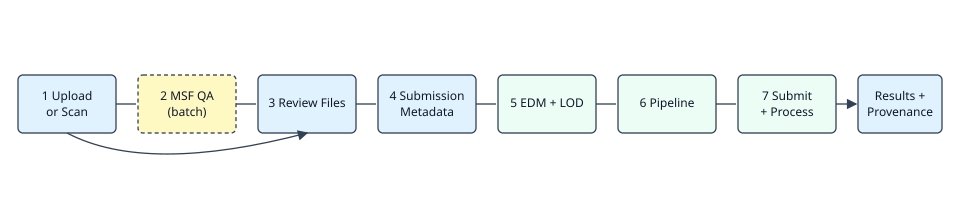

# End-to-End User Guide (With Step Rationale)

This guide explains the workflow presented in the WebHDP UI and, for each step, clarifies:
- What the platform does
- Why the step is required
- What output you should expect before proceeding

If a term is unclear, use the [Glossary](glossary.md). For a broader map of task-based guides, see the [Workflow Guide](workflows.md).

## Preconditions
- You can sign in to WebHDP.
- Setup has been completed by an administrator.
- Required integrations (Zenodo, storage, optional renderer) are configured.

## Workflow Overview

Canonical session states:
- `queued`: upload/scan work is still in progress
- `scanned`: upload and metadata registration are complete; workflow can resume from review/submit
- `submitting`: submit pipeline is running
- `completed`: submit pipeline finished successfully
- `failed`: upload or submit pipeline ended with a blocking failure

## Step 1: Upload / Scan
What you do:
- Choose file upload or directory/ZIP ingestion.
- In batch mode, provide/select MSF metadata source.

What happens internally:
- A new session is created.
- Files are staged for scanning and registered in the session `.hdpc`.
- MSF context is analyzed and saved when available.
- In async ingestion, a task ID is returned and progress can be polled.
- No Zenodo record is created during upload.

Why this step is required:
- It establishes a deterministic session boundary.
- All downstream metadata and provenance are anchored to this session.

Proceed when:
- For non-batch uploads, session status is `scanned` and file nodes become available.
- For MSF-driven batch uploads, the UI opens MSF QA or record-resolution review.

## Step 2: MSF QA (Batch Only)
For MSF-driven batch uploads, WebHDP may open guided MSF QA before file review. This step applies parse options, shows MSF validation issues, supports guided repair, and may start the real local scan after a prepared local workflow session is ready.

What you do:
- Review MSF parse settings and detected columns.
- Apply suggested fixes for blocking MSF issues or choose an explicit accepted action where the UI allows it.
- If local storage mode prepared the session before scanning, start the local workflow scan from this page.

What happens internally:
- WebHDP stores the active MSF path, MSF profile, parse options, file metadata map, and minimum viable LOD preferences.
- Repaired MSF copies can become the active MSF for the workflow while preserving the original path for provenance.
- Local prepared sessions do not proceed to file review until the scan is explicitly started and completed.

Why this step is required:
- Batch publication depends on the MSF as the record and metadata authority.
- Fixing MSF issues before file selection prevents invalid or incomplete batch records from entering the submit pipeline.

Proceed when:
- Blocking MSF issues are resolved or deliberately accepted.
- Any required record-resolution plan is saved.
- The scan has completed and the workflow can open Review Files.

### Batch Record-Resolution Review
For MSF-driven batch uploads, WebHDP may open a record-resolution review before guided MSF repair continues. This review is where duplicate, versioning, and global hash collision warnings are resolved.

Global hash collision warnings appear when an uploaded source file has the same SHA256 content hash as a source file already present in an accessible WebHDP `.hdpc` inventory. The warning displays the colliding Zenodo records that the current user can see, including links that open the Zenodo record in a new tab. If additional matches are outside the user's access scope, the review shows a hidden-match count.

What you do:
- Review the warning and any listed Zenodo records.
- Choose an action for the affected candidate: create a fresh record, create a version when that action is allowed, or skip the candidate.
- Save the record-resolution plan.

What happens internally:
- Hash collision candidates are warnings, not blockers.
- Small files, configured sidecar extensions, and generated renders/previews are ignored according to the admin policy.
- The batch workflow can continue only after every affected candidate has a saved action.

## Step 3: Review Files
What you do:
- Inspect discovered file bundles/nodes.
- Select assets for processing.

What happens internally:
- System merges scan results with DB statuses.
- In batch mode, matched assets can be preselected.
- Record explorers may still be empty at this stage if the session has not been submitted yet.
- If the session has Cloud Storage mirrors for uploaded source artifacts, WebHDP checks provider availability and shows them in the Cloud Storage downloads panel.

Why this step is required:
- Prevents accidental processing of irrelevant or invalid assets.
- Makes input scope explicit and auditable.

Proceed when:
- Selected file set is complete and validated.

### Cloud Storage Downloads
When cloud mirroring is active for a new session, the review-files step includes a compact Cloud Storage downloads panel. It can provide owner-only download buttons for the raw artifacts uploaded through WebHDP: single source files, batch ZIP archives, and uploaded MSF files.

The panel also reports why a cloud download is unavailable. Common reasons include HPC/local storage mode, `server_only` mode, missing provider credentials, an unreachable provider, a missing cloud object, or a failed mirror upload. Existing raw `.hdpc` and shared `.hdpc` downloads are separate and continue to work according to their existing policies.

## Step 4: Submission Metadata
What you do:
- Fill metadata form (manual mode) or review MSF-derived mappings (batch mode).

What happens internally:
- Metadata draft is autosaved.
- On final save, payload is normalized and validated.

Why this step is required:
- High-quality metadata is mandatory for discoverability, interoperability, and standards compliance.
- Early validation reduces costly downstream failures.

Proceed when:
- Validation passes without blocking errors.

## Step 5: EDM and LOD
What you do:
- Select EDM template.
- Preview rendered XML.
- Run validation report.
- Confirm LOD mapping and minimum viable output preferences when available.

What happens internally:
- Jinja-based template rendering occurs with your metadata.
- Validation combines basic checks, XSD, Schematron, and business rules.
- Template, provider, primary file, MSF path, LOD mapping, and minimum viable choices are saved to the metadata draft.

Why this step is required:
- Ensures export quality before publication.
- Makes schema/business-rule violations visible and actionable.

Proceed when:
- XML preview is correct and validation is acceptable.

## Step 6: Pipeline
What you do:
- Choose the processing pipeline for the selected files and metadata.
- Review enabled pipeline steps before continuing.
- When available, run optional 3D analysis or derivative pipelines before publication to check technical readiness.

What happens internally:
- WebHDP loads available native pipeline definitions.
- The selected pipeline is persisted in workflow state and passed to the submit step.
- If a required session, selected file set, or pipeline is missing, the UI routes back to the step that must be completed first.

Why this step is required:
- Pipeline selection determines which processing, validation, generation, HPC-backed component, and Zenodo operations can run.
- It makes the execution plan explicit before publication starts.

Proceed when:
- A pipeline is selected and the workflow opens Submit.

### Optional 3D Readiness Checks
Some deployments expose optional 3D HDP Component pipelines before final
publication. Use `3d_prepublication_analysis` to inspect geometry, dependencies,
viewer readiness, fingerprints, and point-cloud or mesh characteristics without
changing the scholarly source asset. Use derivative pipelines only when repaired,
normalized, optimized, or canonical GLB outputs should be created as explicit
derivatives.

These reports support review; they do not replace rights, license, access,
cultural sensitivity, or curator approval decisions. Keep the run ID, pipeline
version, component versions, and report artifacts with the session provenance
when technical findings are used in project documentation or publication notes.

## Step 7: Submit and Process
What you do:
- Confirm pipeline and execution options.
- Confirm the publishing workspace and credential source.
- Choose Sandbox vs Production target.
- Start processing.

What happens internally:
- Submission record is created.
- On the first submit, local records are created exactly once from the selected files and final metadata.
- On reruns or later operations, the pipeline reuses persisted `record_ids` instead of recreating records from upload paths.
- Pipeline orchestrates optional render/USDZ work, EDM/IIIF/METS generation, LOD generation, and Zenodo operations.
- Progress state is persisted and surfaced to UI.

Publishing context resolution:
- If the session prefers user credentials and the publishing user has an active Zenodo key for the chosen environment, that key is used.
- Active keys may be owned by the publishing user or accepted shares from another user.
- Otherwise, if the session belongs to an institution with a credential for the chosen environment, the institution token is used.
- Otherwise, WebHDP falls back to the system Zenodo environment variable.
- Pending, declined, revoked, deleted, inaccessible, or wrong-environment shared keys are not eligible for upload resolution.

Zenodo key privacy:
- User-managed keys are named in the account profile, encrypted at rest, and displayed only as masked previews.
- Sharing a key grants approved access to the encrypted credential record, not the cleartext token.
- One Sandbox key and one Production key can be active for a user at a time.
- Live validation intentionally creates and deletes a temporary Zenodo draft to prove write access, so Production validation should be run only when that explicit check is intended.

LOD policy:
- `required`: LOD generation failure blocks Zenodo upload for that record.
- `optional`: LOD generation failure is recorded as a warning and upload can continue.
- `disabled`: LOD generation is skipped.

Current baseline note:
- In the current implementation, submission execution is centered on predefined/default pipeline IDs maintained by WebHDP integration.
- Future updates are planned to emphasize HDP component-driven pipeline composition.

Why this step is required:
- Converts curated input into publication-ready deliverables in a controlled, traceable pipeline.

Proceed when:
- Submission reaches `completed` state.

## Results and Verification
After completion, review:
- Submission status and timings
- Session records list
- Per-record detail pages
- Session provenance report
- Cross-session explorer (if available to your role)

Why this phase matters:
- It validates scientific reproducibility, not just technical success.

## Recommended User Validation Checklist
- Title/description and creators are correct
- Rights/license fields are present and appropriate
- EDM validation has no blocking issues
- Optional 3D readiness reports have been reviewed when the project uses 3D analysis components
- Source files, derivatives, reports, and previews are labeled distinctly
- Zenodo links/record IDs are present
- Expected files were included in each record
- Provenance mappings reflect the intended metadata source

## Common User Mistakes to Avoid
- Uploading assets without matching MSF naming conventions
- Skipping metadata completeness for required Zenodo fields
- Ignoring warnings that indicate downstream discoverability problems
- Running production uploads before validating in sandbox

For operational troubleshooting, see the [Troubleshooting Guide](troubleshooting.md).
