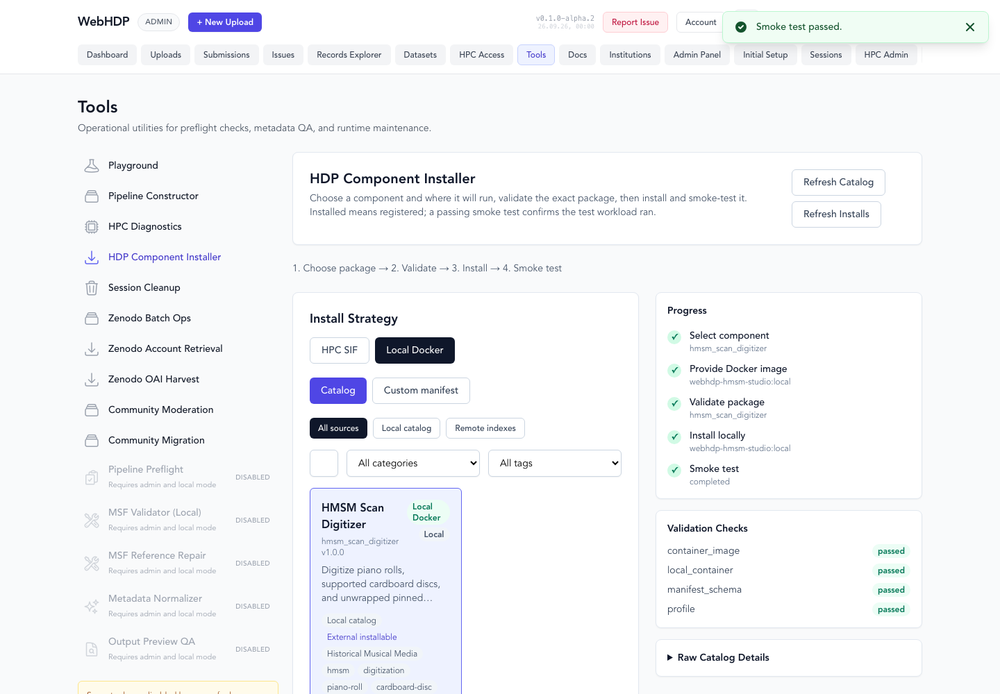
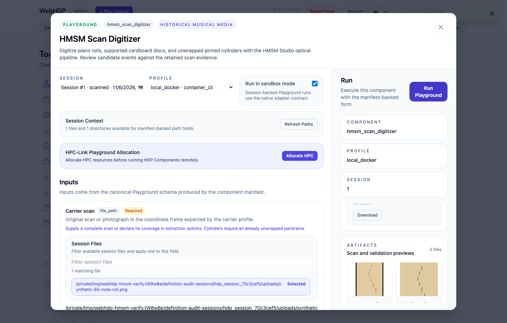
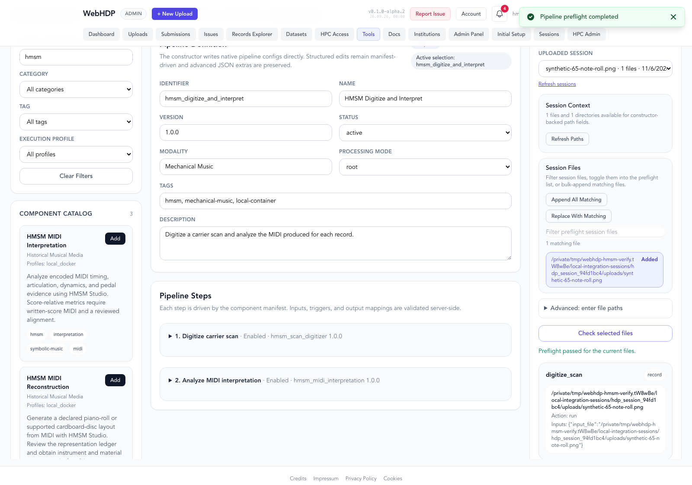
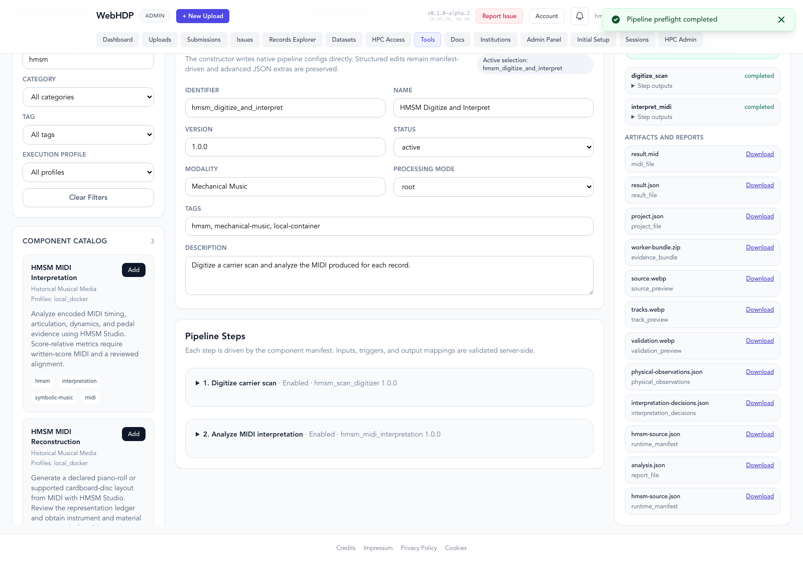

# HMSM Studio components and pipelines in WebHDP

Use the HMSM Studio components to digitize a mechanical-music carrier, analyze MIDI, or generate a physical layout study from MIDI. All three run the same processors from an explicit HMSM Studio source snapshot. The local installer uses Docker. Hosted WebHDP can run the processors through HPC-Link with a checksum-pinned Singularity image.

| Saved pipeline | Input | Main results |
| --- | --- | --- |
| HMSM Scan Digitization | Roll scan, supported cardboard-disc image, or unwrapped cylinder panorama | Candidate events, MIDI, stage previews, optical ledgers, and evidence ZIP |
| HMSM MIDI Interpretation | Standard MIDI File | Timing, articulation, dynamics, pedal, and optional score-relative measurements |
| HMSM MIDI Reconstruction | Standard MIDI File and a supported roll or disc model | SVG layouts, print PDF when available, playback MIDI, and a fixity-checked evidence ZIP |
| HMSM Digitize and Interpret | Carrier scan | Both the extraction outputs and an interpretation report for the extracted MIDI |

## Build and install locally

1. Run the image build from the WebHDP repository root with Python 3.11 or later. Point `--source` at the root of your HMSM Studio Git checkout.

   ```sh
   python3 scripts/build_hmsm_runtime.py --source /path/to/interactive-hmsm
   ```

   The image is tagged `webhdp-hmsm-studio:local`. The build uses the checkout's current allowlisted source files, including local edits. The runtime receipt records the Git commit, packaged-file hashes, and whether the packaged source differs from the commit. The build leaves Studio data, archive files, and credentials outside the image.

2. Run a local WebHDP instance with `WEBHDP_DEPLOYMENT_MODE=local`, `WEBHDP_ALLOW_LOCAL_HDP_COMPONENTS=true`, and `WEBHDP_CORE_ONLY=false`. The backend and task worker need the Docker CLI, the same Docker context used for the build, and a session directory that the Docker daemon can bind-mount. With a named Docker context, pass `--docker-context` to the build and set `DOCKER_CONTEXT` for the WebHDP processes. Keep temporary smoke-test directories on a mount that Docker can reach as well. See the [operations and setup guide](operations_and_setup_guide.md).

3. Sign in as an admin. Open **Tools → HDP Component Installer**, select **Local Docker**, and search the local catalog for **HMSM**. For each component, select **Validate Package**, **Install Locally**, and **Run Smoke Test**. The smoke test checks that the component creates its required files. The installer pins the resolved image ID. To adopt a rebuilt image, install a new component version and save a pipeline version that references it.



## Install for hosted Playground

1. Build the HMSM runtime for the cluster's Linux architecture. Package the
   runtime as a Singularity SIF, including `/app/component_runner.py` and
   `/app/hmsm-source.json`. Keep the source snapshot receipt and verify the
   scan, interpretation, and reconstruction fixtures in that image.
2. Put the SIF on private storage readable by the HPC-Link account. Compute
   its SHA-256 and generate three install requests with the command below.

   ```sh
   python scripts/hpc_singularity/package_hmsm.py \
     --sif /work/project/images/hmsm-studio.sif \
     --sha256 "$sif_sha256" --version 1.0.1
   ```

   The output is JSON keyed by component name. In **Tools → HDP Component
   Installer → HPC SIF**, supply each request's manifest, SIF path, and
   checksum. Installation needs administrator access to both registries.
   See [HDP Component installation](hdp_component_hpc_installation.md).
3. Upload a carrier scan or MIDI file and attach an active HPC-Link allocation
   to that upload session. In **Tools → Playground**, search for **HMSM** and
   run the corresponding component with its `hpc_singularity` profile. HMSM
   uses CPU cores and memory within the allocation.

## Try the scan in Playground

The smoke-test files are embedded in the manifests. To extract both synthetic fixtures into a local sample directory, run the following from the WebHDP repository root with the project's Python environment active.

```sh
python - <<'PY'
import base64
from pathlib import Path

import yaml

samples = Path("local_input") / "hmsm-demo"
samples.mkdir(parents=True, exist_ok=True)
for key in ("hmsm_scan_digitizer", "hmsm_midi_reconstruction"):
    manifest = yaml.safe_load(Path("external_code", key, "component.yaml").read_text())
    for fixture in manifest["install"]["test"]["files"]:
        (samples / fixture["name"]).write_bytes(base64.b64decode(fixture["content_base64"]))
print(samples.resolve())
PY
```

1. Select **New Upload → Direct file upload**, choose `synthetic-65-note-roll.png`, and finish the upload. For the two MIDI components, upload `synthetic-study.mid` the same way.
2. Open **Tools → Playground**, search for **HMSM Scan Digitizer**, and open its form. Select the scan session, choose `local_docker`, and select **Use** next to the scan under **Carrier scan**.
3. Keep model `generic_65_no_dynamics` for the fixture and select **Run Playground**. Inspect the source and track previews, then download `result.mid`, `result.json`, and `worker-bundle.zip` from the result panel. The expected pitches in scan order are **60, 64, 67, 64, 60, 55, 48**.



## Run the saved pipeline

1. Open **Tools → Pipeline Constructor** and select **HMSM Digitize and Interpret**. Its two steps bind the digitizer's `midi_file` directly into the interpretation component.
2. Open **Diagnostics** if it is collapsed. In **Preflight**, select the uploaded scan session and add the scan under **Session Files**. Select **Check selected files**. Preflight checks the selected file's extension and the saved bindings. The digitizer checks the actual scan when it runs.



3. Select **Run Pipeline**. When both steps complete, use **Artifacts And Reports** to download `result.mid`, `analysis.json`, and the scan evidence. The standalone pipelines use the same controls. Select a scan session for **HMSM Scan Digitization**, or a MIDI session for **HMSM MIDI Reconstruction** and **HMSM MIDI Interpretation**.



These pipelines can run immediately after upload. WebHDP keeps the output artifacts and their local prepared record in the session. In a chained run, the interpretation report's `provenance.source_sha256` identifies the MIDI produced by the first step.

## Use a different carrier or score

- Use a TIFF, PNG, JPEG, or WebP scan and choose an HMSM model that matches the carrier. You can use a built-in model ID or supply a raw `MediaModel` JSON file in Playground. In the Constructor, set the model ID and paste any processing options as JSON under the step's **Parameters**. Validate the edits, publish the version locally, and preflight it.
- Stage optional JSON or score MIDI beside the primary file in a batch session. Scan digitization reads `ExtractionOptions`, reconstruction reads `GenerationOptions`, and interpretation reads `AnalysisOptions`. Use either the options file or inline JSON. A frozen optical classifier requires its matching ID and SHA-256 in the extraction options.
- If a performance MIDI contains independent Type-2 sequences, select one with `sequence_track`. Use a synchronous Type-0 or Type-1 MIDI for the written score. Interpretation reports score-relative measures when it can align the inputs. For a reconstruction profile that references artwork from the Studio asset registry, set `artwork_policy` to `none` for this standalone runtime.
- Retain `hmsm-source.json` with the scientific outputs. Keep the optical ledgers, any disc coverage mask, and the roll substrate support report when present alongside the scan ZIP. The Studio worker ZIP retains its native format. The separate ledgers preserve candidate and abstention decisions. Reconstruction's `manifest.json` and bundled `verify.py` check output fixity. Review the model evidence and omissions before drawing conclusions about the carrier or using physical-scale geometry.

Collection accounts, archive and cloud intake, historical acceptance reviews, and the Paula campaign operate in HMSM Studio.
