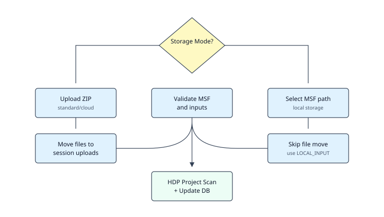

# HDP Web: Storage Modes Architecture

This document describes the architectural divergence between the **Cloud/Standard Mode** and **Local Storage Mode** in the WebHDP application. These modes fundamentally alter how files are ingested, processed, and stored.

## 1. Executive Summary

| Feature | **Cloud / Standard Mode** | **Local Storage Mode** |
| :--- | :--- | :--- |
| **Primary Use Case** | Users uploading new datasets from their local machine. | HPC/Server users processing massive existing datasets on attached storage. |
| **Input Method** | **Upload**: Large ZIP file + MSF (.xlsx). | **Selection**: Select existing MSF from server path; Input dir is inferred. |
| **Data Movement** | **High**: Files uploaded -> Extracted -> Moved to Session Dir. | **Zero-Copy**: Files remain in read-only input mount; Scanned in-place. |
| **Storage Requirement** | Requires writeable `uploads` volume (2x dataset size for zip+extraction). | Requires read-only mount of `LOCAL_INPUT_PATH`. |
| **Async Task** | Extracts ZIP, validates, moves files. | Skips extraction, validates in-place, skips move. |
| **Cloud Downloads** | Available for new uploaded artifacts when `pure_cloud` or `cloud_backup` mirroring is active. | Explicitly unavailable; no cloud mirror objects are created. |

---

## 2. Configuration

The mode is controlled via the `STORAGE_MODE` environment variable in `.env` (loaded by `services/cloud_upload_service.py`).

*   **Standard/Cloud**: `STORAGE_MODE=pure_cloud`, `cloud_backup`, or `server_only`.
*   **Attached filesystem storage**: `STORAGE_MODE=local` for explicit workstation-local folder scans or server/HPC attached storage.

Additional config for Local Mode:
*   `LOCAL_INPUT_PATH`: Absolute path on the container (mapped to host) where datasets reside.

---

## 3. Frontend Architecture (`UploadView.vue`)

The frontend component `src/views/workflow/UploadView.vue` adapts its UI based on the `/admin/storage-status` API response.

### 3.1. Standard Mode Behavior
1.  **UI State**: Shows a **Drop Zone** for a ZIP file.
2.  **User Action**: User streams a large ZIP upload.
3.  **Progress**:
    *   Step 1: Uploading ZIP (0-100%).
    *   Step 2: Processing (Server extracts).
4.  **API Call**: POSTs `zip_file` (binary) + `msf_file` to `/sessions/directory`.
5.  **Cloud Download State**: In `pure_cloud` and `cloud_backup`, the review-files step shows owner-only Cloud Storage download availability for newly uploaded source artifacts. In `server_only`, it shows that cloud mirroring is disabled.

### 3.2. Local Storage Mode Behavior
1.  **UI State**: Hides ZIP Drop Zone. Shows a **Dropdown Selector** for MSF files.
    *   Calls `/sessions/local-msf` to list `.xlsx` files found in `LOCAL_INPUT_PATH`.
2.  **User Action**: Selects an MSF file (e.g., `project_metadata.xlsx`).
3.  **Progress**:
    *   Step 1: "Initializing Local Scan" (Instant).
    *   Step 2: "Indexing & Matching" (Fast).
4.  **API Call**: POSTs `msf_path` (string) to `/sessions/directory`. **No file content is uploaded.**
5.  **Cloud Download State**: The review-files step shows that Cloud Storage downloads are unavailable because the session uses HPC/local storage.

---

## 4. Backend Routing (`session_routes.py`)

The route `POST /sessions/directory` acts as the unified entry point but branches early.

### 4.1. Request Handling
*   **Local Mode**:
    *   Extracts `input_directory_path` from `config['LOCAL_INPUT_PATH']`.
    *   Ignores/Forbids `zip_file` upload.
    *   Accepts `msf_path` (relative path from input root).
*   **Standard Mode**:
    *   Requires `zip_file` in `request.files`.
    *   Saves ZIP to a persistent `uploads_path` immediately before invoking the task.

### 4.2. Session Creation
In both cases, a `Session` DB record is created synchronously via `_create_session_dirs()` to generate a `session_id`. This ID is passed to the async task.

### 4.3. Cloud Mirror Metadata
For newly uploaded browser artifacts, WebHDP creates `cloud_mirror_objects` rows only when mirroring is active. The mirror record points to the uploaded single source file, batch ZIP, or uploaded MSF file and is later used by the owner-only `/cloud-downloads` APIs.

Local/HPC mode and `server_only` do not create mirror rows. Those sessions report an explicit unavailable reason instead of presenting a stale or misleading download action.

---

## 5. Async Task Logic (`tasks.py`)

The Celery task `process_bulk_upload_task` contains the critical divergence logic.

### 5.1. ZIP Extraction
*   **Standard Mode**:
    ```python
    with zipfile.ZipFile(zip_path, 'r') as zip_ref:
        safe_extract_zip(zip_ref, extract_dir)
    ```
    *   **Cost**: High I/O and CPU.
    *   **Context**: Working in temporary `extract_dir`.

*   **Local Mode**:
    ```python
    if storage_mode == STORAGE_MODE_LOCAL:
        input_directory_path = current_app.config.get("LOCAL_INPUT_PATH")
        # Extraction skipped completely
    ```
    *   **Cost**: Near zero.
    *   **Context**: Working directly in `LOCAL_INPUT_PATH`.

### 5.2. File Persistence ( The "Move" Step)
This is the most dangerous divergence point. Standard mode *must* move files to the session folder to persist them. Local mode *must not* touch them (often read-only).

*   **Standard Mode**:
    ```python
    # Move extracted files to persistent uploads directory
    shutil.move(source, destination)
    # Updates input_directory_path -> session_uploads_path
    ```
*   **Local Mode**:
    ```python
    if storage_mode != STORAGE_MODE_LOCAL:
        # Code block to move files is SKIPPED
    # input_directory_path remains pointing to /data/local_input
    ```

### 5.3. Project Scanning
`ProjectService.create_and_scan()` is called in both modes but with different path origins.
*   **Standard Mode**: Scans the private `session_dir/uploads`.
*   **Local Mode**: Scans the shared `LOCAL_INPUT_PATH`.

---

## 6. Logic Flow Diagram


